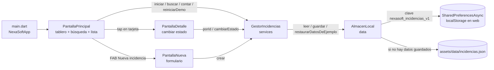

# Mapa de componentes — NexaSoft Incidencias (versión heredada)

> Documento elaborado a partir de la lectura del código del commit del Día 1 (`9c6d1fd`), antes de cualquier corrección.

## 1. Estructura de `lib/`

```
lib/
├── main.dart                         Punto de entrada. Crea MaterialApp (tema azul NexaSoft) y abre PantallaPrincipal.
├── model/
│   └── incidencia.dart               Modelo de datos Incidencia + conversión JSON (desdeJson / toJson).
├── data/
│   └── almacen_local.dart            Acceso a datos: lee la semilla JSON de assets/ o lo guardado en almacenamiento local.
├── services/
│   └── gestor_incidencias.dart       Lógica de negocio: lista en memoria, búsqueda, conteo por estado, crear, cambiar estado, reiniciar demo.
└── ui/
    ├── pantalla_principal.dart       Pantalla principal: tablero de totales, buscador, lista, botón "Nueva incidencia" y botón "Restablecer demostración".
    ├── pantalla_detalle.dart         Detalle de una incidencia y selector (Dropdown) para cambiar el estado.
    └── pantalla_nueva.dart           Formulario para registrar una incidencia nueva.
```

Otros archivos relevantes:

| Archivo | Uso |
|---|---|
| `assets/data/incidencias.json` | Semilla de datos ficticios (10 incidencias, INC-101 a INC-110). |
| `pubspec.yaml` | Dependencia de almacenamiento: `shared_preferences: ^2.5.6`. Declara el asset JSON. |
| `test/widget_test.dart` | Única prueba original: conversión `Incidencia.desdeJson` / `toJson`. |

## 2. Modelo de datos — `lib/model/incidencia.dart`

Clase `Incidencia` (campos mutables, todos `String`):

| Campo | Ejemplo | Valor por defecto en `desdeJson` |
|---|---|---|
| `id` | `INC-102` | `''` |
| `titulo` | `WiFi intermitente en recepción` | `''` |
| `descripcion` | `La red inalámbrica se desconecta…` | `''` |
| `cliente` | `Clínica del Prado` | `''` |
| `categoria` | `Redes` (`Software` / `Hardware` / `Redes`) | `'Software'` |
| `estado` | `Pendiente` / `En proceso` / `Resuelta` | `'Pendiente'` |
| `fecha` | `2026-09-29` (texto ISO, solo fecha) | `''` |

- `Incidencia.desdeJson(Map)` → crea el objeto desde un mapa JSON.
- `toJson()` → devuelve el mapa con los 7 campos (no pierde ninguno, incluido `estado`).

## 3. Carga de datos iniciales

- **Archivo:** `assets/data/incidencias.json` (registrado en `pubspec.yaml`).
- **Dónde se lee:** `AlmacenLocal.leer()` en `lib/data/almacen_local.dart`.
- **Regla:** si existe un valor guardado bajo la clave local, se usa ese; **solo si no existe** se carga la semilla con `rootBundle.loadString('assets/data/incidencias.json')`.
- **Quién lo invoca:** `GestorIncidencias.iniciar()` ← `_PantallaPrincipalState.cargar()` ← `initState()`.

## 4. Almacenamiento local

| Aspecto | Detalle |
|---|---|
| Paquete | `shared_preferences` (API `SharedPreferencesAsync`). En web (Chrome) se guarda en `window.localStorage` del navegador. |
| Clave | `nexasoft_incidencias_v1` (constante `clave` en `AlmacenLocal`). La misma para leer, guardar y borrar. |
| Formato | Un único `String` con la lista completa serializada en JSON (`jsonEncode` de `toJson()` de cada incidencia). |
| Lectura | `AlmacenLocal.leer()` (al iniciar la app y después de restablecer). |
| Escritura | `AlmacenLocal.guardar(lista)`. **En el código original solo la llama `GestorIncidencias.crear()`.** `cambiarEstado()` no guarda (ver BUG-001). |
| Borrado | `AlmacenLocal.restaurarDatosDeEjemplo()` → `prefs.remove(clave)`; lo usa `GestorIncidencias.reiniciarDemo()` (botón "Restablecer demostración"). |

> Nota (web): `localStorage` es por **origen** (protocolo + host + **puerto**). `flutter run -d chrome` usa un puerto aleatorio en cada ejecución salvo que se fije con `--web-port`, por lo que al relanzar con `flutter run` los datos guardados pueden no encontrarse. Para pruebas de persistencia usar siempre el mismo puerto, p. ej. `flutter run -d chrome --web-port=8080`.

## 5. Tablero de totales (Pendientes / En proceso / Resueltas)

- **UI:** `pantalla_principal.dart`, método `build()` → tres llamadas a `resumen(...)` con `g.contar('Pendiente')`, `g.contar('En proceso')`, `g.contar('Resuelta')`.
- **Cálculo:** `GestorIncidencias.contar(estado)` en `lib/services/gestor_incidencias.dart`.
  - Para `'Pendiente'` devuelve el **contador aparte** `cantidadPendientes` (calculado en `iniciar()` e incrementado en `crear()`).
  - Para los otros estados cuenta sobre la lista completa `incidencias`.
- El texto "N registros" sobre la lista es `items.length`, donde `items = g.buscar(busqueda)` (lista filtrada por la búsqueda).

## 6. Búsqueda

- **UI:** `TextField` "Buscar incidencias" en `pantalla_principal.dart`; `onChanged` guarda el texto en `busqueda` y redibuja.
- **Lógica:** `GestorIncidencias.buscar(String texto)`:
  - Si `texto.trim()` está vacío → devuelve toda la lista.
  - Si no → `incidencias.where((x) => x.titulo.contains(texto))` (sensible a mayúsculas, solo título, sin `trim` del texto buscado).

## 7. Flujo entre componentes



Versión en texto:

```
PantallaPrincipal ──► PantallaDetalle ──┐
        │          └► PantallaNueva ────┤
        └───────────────────────────────┴──► GestorIncidencias (memoria) ──► AlmacenLocal ──► SharedPreferences (clave nexasoft_incidencias_v1)
                                                                                      └──► assets/data/incidencias.json (semilla)
```

Las tres pantallas comparten **la misma instancia** de `GestorIncidencias` (creada en `_PantallaPrincipalState` y pasada por constructor), por lo que los cambios en memoria se ven al volver a la lista.
